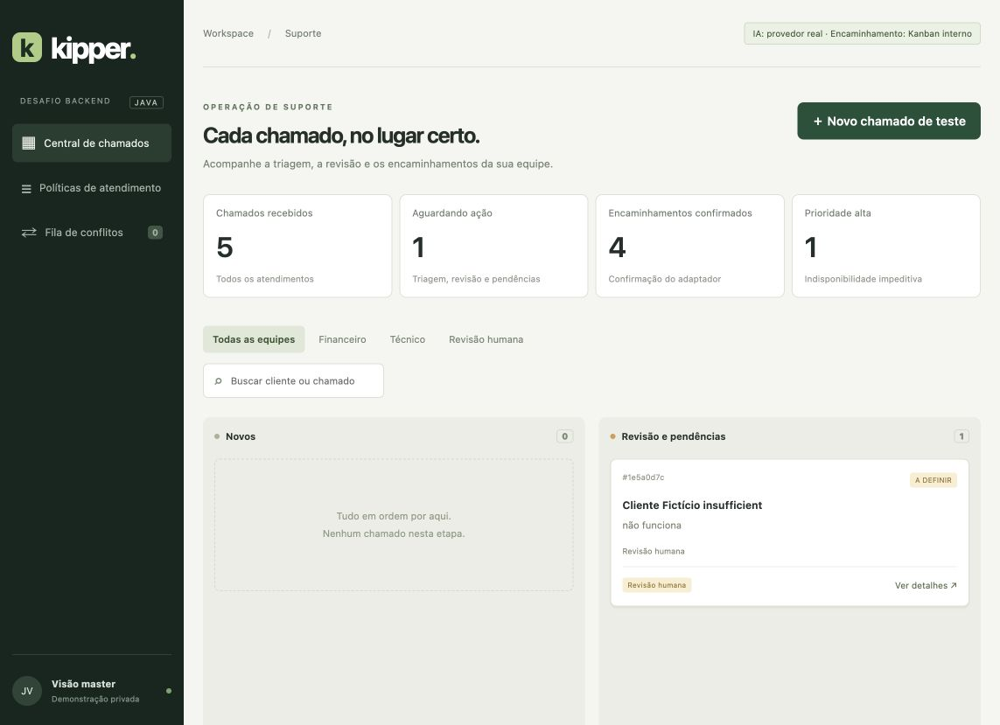
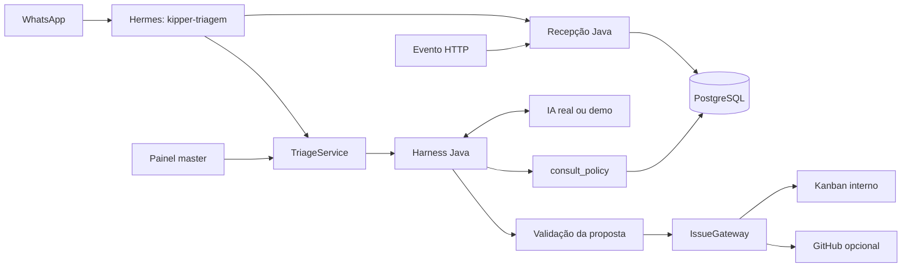

# Triagem de suporte · Kipper Academy

[](https://github.com/jvcorado/desafio-junior-backend-kipper-academy./actions/workflows/verify.yml)

Backend Java para receber eventos de suporte, consultar políticas por ferramenta de IA, validar a triagem e encaminhar ao Kanban interno ou criar GitHub Issues. Painel master com filtros por equipe, gestão de políticas e revisão de conflitos.

Implementação da `spec-triagem-suporte-kipper-v1.docx`, fornecida por JV, consolidada em 05/11/2026. Código desenvolvido com auxílio de IA (Codex). A aula exata a citar e o prazo da plataforma ainda precisam ser confirmados por João.

**Tecnologias:** Java 21, Spring Boot 3.5.7, Maven Wrapper, JDBC, Flyway, PostgreSQL e interface HTML/CSS/JavaScript sem etapa de build adicional.



## Estado da entrega

- Backend ativo na VPS, com banco/usuário exclusivos e quatro migrações Flyway. O painel é privado e acessível por túnel SSH.
- IA real e Kanban validados: cinco cenários fictícios, quatro encaminhamentos confirmados e um caso em revisão. Cada análise consultou a política por chamada nativa de ferramenta.
- 27 testes Java aprovados em H2 e PostgreSQL e 12 testes Python aprovados; pipeline automático no GitHub.
- WhatsApp: perfil e rota dedicados instalados, coleta de dados faltantes confirmada. **Persistência do fluxo WhatsApp → Kanban ainda em validação de conectividade privada.**

O padrão local continua sendo a demonstração simulada, para reproduzir o projeto sem credenciais de IA ou acesso à VPS. Os modos utilizados aparecem no próprio painel. [Evidências e pendências](docs/validacao.md).

## Rodar em dois comandos

Requer **JDK 21**, internet na primeira instalação e shell compatível com o Maven Wrapper. No Windows use `mvnw.cmd`.

```sh
./mvnw verify
./mvnw spring-boot:run
```

Abra [a central local](http://localhost:8080). O padrão é uma demonstração **com IA simulada e encaminhamento simulado**, claramente identificados no painel. Os dados persistem em `data/triagem.mv.db` (H2). Não há conta de usuário: o servidor aceita somente loopback. Para acesso da mentora, use um túnel privado ao servidor; não publique a edição sem proteção.

Crie um chamado fictício e clique **Iniciar triagem**. O recebimento e o processamento são etapas separadas; não há worker nem repetição automática. `FORWARDED` confirma o adaptador utilizado; na demonstração, não representa uma issue real. Somente o botão de encerramento humano leva a `CLOSED`.

O simulador conhece explicitamente os cenários “cobrado duas vezes”, “cobrança duplicada”, “produto está indisponível”, “não consigo usar o produto” e “consigo usar o produto”. Outros textos vão para revisão. Ele exercita a mesma ferramenta e a mesma validação do adaptador de IA real e **não comprova inferência real**.

## Eventos e demonstração

```sh
curl -i http://localhost:8080/api/events -H 'Content-Type: application/json' --data-binary @examples/billing.json
curl -i http://localhost:8080/api/events -H 'Content-Type: application/json' --data-binary @examples/billing.json
curl -i http://localhost:8080/api/events -H 'Content-Type: application/json' --data-binary @examples/conflict.json
curl -i http://localhost:8080/api/events -H 'Content-Type: application/json' --data-binary @examples/incomplete.json
```

Respostas, respectivamente: **201 CREATED**, **200 REPEATED**, **409 CONFLICT** com ID da fila e **201 CREATED**. Inicie a triagem pelo painel ou `POST /api/tickets/{id-interno}/process` com `Content-Type: application/json` e corpo `{}`. Consulte pelo ID retornado ou `GET /api/tickets/lookup?source=whatsapp-test&ticketId=support-demo-001`.

Nome, WhatsApp E.164, mensagem, origem, IDs e horário são obrigatórios. A chave é `(source,eventId)`. A igualdade usa SHA-256 da representação JSON canônica dos oito campos do contrato; datas equivalentes são normalizadas por `Instant`, mas alterações em texto, espaços, nome, número ou horário são mudanças de payload. O número não é chave. A unicidade transacional protege concorrência; a segunda mensagem divergente é preservada e deduplicada na fila. `ticketId` também é único por origem: reutilizá-lo para evento diferente gera conflito. Uma retransmissão devolve a mesma referência persistida; o estado atualizado está na consulta.

O revisor master libera conflito com **novos IDs de evento e de atendimento**, ou descarta com justificativa. A referência original permanece. Não há liberação automática. [Contrato completo da API](docs/api.md).

## PostgreSQL

O schema e o catálogo são criados pelo Flyway. Há quatro migrações: entidades, políticas iniciais, ações humanas e confirmações do Kanban. H2 serve para execução local sem infraestrutura; os testes também são executáveis no PostgreSQL real.

Para um PostgreSQL **local de desenvolvimento** via Docker:

```sh
export DATABASE_PASSWORD='troque-por-uma-senha-local'
docker compose up -d postgres
export DATABASE_URL='jdbc:postgresql://127.0.0.1:15432/triagem_java'
export DATABASE_USER='triagem_java'
./mvnw spring-boot:run
```

Esse Compose cria uma instância local, não provisiona a VPS. Na Hostinger, usar banco e role próprios com privilégios restritos, sem abrir porta pública. Confira backup e restauração antes de guardar dados importantes. [Preparação da VPS](docs/infraestrutura.md).

Na VPS de JV, o backend está conectado a `triagem_java`: serviço privado em **127.0.0.1:18080**, Flyway V1–V4 e três políticas. Acesso por túnel SSH em [localhost:18080](http://localhost:18080). IA real `gpt-6.1-sol` e encaminhamento ao Kanban interno foram validados com cinco cenários fictícios. [Evidência da IA real](docs/ia-real-verificacao.json) e [operação](docs/infraestrutura.md).

O Spring lê as variáveis do processo; **não carrega `.env` automaticamente**. `.env.example` documenta os nomes. Nunca versione `.env`, chaves ou senhas. Um arquivo privado pode ser carregado pelo serviço/shell conforme o ambiente. A troca do H2 para PostgreSQL não copia dados existentes.

## IA e GitHub reais

JV escolheu o **Kanban deste painel** para os testes integrados. `DELIVERY_MODE=panel` grava uma confirmação durável em `kanban_handoffs`, única por chamado, e fornece link para seu cartão. Reenvios consultam essa mesma confirmação. Esse encaminhamento é real dentro do painel; não representa uma issue GitHub nem resolução do problema.

Configure `AI_MODE=http`, `AI_URL`, `AI_API_KEY` e `AI_MODEL` para um provedor que suporte o protocolo OpenAI Chat Completions com tool calling. `AI_URL` é a URL completa de `/v1/chat/completions`. O harness limita o ciclo a seis respostas (configurável de 1 a 12), aceita somente `consult_policy` e um argumento `category` enumerado, consulta o banco e devolve o resultado ao modelo. Depois exige proposta JSON, política consultada e versão, equipe coerente, suficiência e evidência literal. Dados do cliente ficam na mensagem de usuário, separados das instruções. Texto do modelo não executa SQL, terminal, edição de catálogo ou ações no GitHub.

Configure `DELIVERY_MODE=github`, `GITHUB_REPOSITORY=owner/repositorio-de-testes` e `GITHUB_TOKEN` (token fine-grained, apenas o repositório necessário, Issues: read/write). O destino de teste deve ser escolhido explicitamente. O título distingue equipe/prioridade; não exige criar labels. Nome, número e ID do cliente não entram na issue, mas a mensagem original e a justificativa entram: **use apenas dados fictícios**. Nenhuma informação real de cliente está autorizada para um repositório público.

HTTP 201 com número e URL válidos confirma criação. Rejeição explícita 4xx (exceto 408) resulta em `DELIVERY_FAILED`; timeout, resposta inválida e 5xx resultam em `DELIVERY_UNKNOWN`. Cada tentativa começa persistida antes do HTTP. Um marcador com UUID interno correlaciona a issue. A reconciliação consulta issues abertas e fechadas, até 20 páginas de 100; ausência não prova falha e **não libera reenvio**. Somente rejeição explícita permite retry pelo mesmo adaptador. Resultado desconhecido permanece pendente até confirmação. Interrupção após início do envio deixa `SENDING`, também reconciliável.

Os adaptadores HTTP têm testes de contrato com servidor local. A chamada real à IA com `consult_policy` e a confirmação do Kanban foram verificadas na VPS. A conversa WhatsApp integrada ainda está em configuração; nenhuma issue GitHub foi criada nessa validação.

## Hermes

Perfis dedicados `kipper-triagem` foram criados no Mac e no Hermes da VPS em 06/11/2026, sem clonar outros perfis. Na VPS, plugin nativo e rota restrita foram instalados no grupo de teste aprovado. A coleta de dados faltantes funcionou; a persistência no Kanban pelo WhatsApp ainda aguarda correção e teste da conexão privada. [Instruções do perfil](integrations/hermes/SOUL.md), [plugin nativo](integrations/hermes/kipper_plugin/__init__.py) e [alternativa MCP](integrations/hermes/mcp_server.py) estão versionados. Leia [integração e limitações](docs/hermes.md).

A rota HTTP genérica do Hermes executa seu próprio ciclo de agente. A integração implantada usa uma ponte privada diferente: `HttpAiModel` → worker fixo `CodexAuxiliaryClient` do Hermes → provedor real, preservando `tool_calls` e mensagens `tool`. O worker não executa ferramentas: o Java executa `consult_policy` e valida a proposta. As credenciais do provedor permanecem no Hermes. [Detalhes e estado do WhatsApp](docs/hermes.md).

## Arquitetura para explicar



É um monólito com injeção de dependências e portas/adaptadores. `TriageService` depende de `IssueGateway`, não de HTTP/GitHub. `AgentHarness` depende de `AiModel`, não do provedor. Trocar `DELIVERY_MODE` e `AI_MODE` troca a implementação injetada e conserva a regra. A suíte usa adapters substituídos sem reescrever a triagem. Isso demonstra inversão de dependência; não significa que toda a aplicação seja uma implementação estrita de Clean Architecture: os serviços usam Spring e o repositório JDBC é concreto. [Decisões e estados](docs/decisoes.md).

Políticas removidas são desativadas. Edição incrementa versão e exige `expectedVersion`. Cada análise preserva snapshot das regras e rastro da ferramenta, mesmo após mudanças. O catálogo não pode revogar as invariantes fixas do desafio. Não há transação de banco aberta durante chamadas externas.

## Testes e entrega

```sh
./mvnw verify
python3 -m unittest discover -s integrations/hermes -p 'test_*.py' -v
# Use exclusivamente um banco vazio e descartável: os testes limpam as tabelas da aplicação.
TEST_DATABASE_URL=jdbc:postgresql://localhost:5432/kipper_test \
TEST_DATABASE_USER=test TEST_DATABASE_PASSWORD=test ./mvnw test
```

A suíte cobre validação, concorrência, idempotência, fila/liberação, classificação, ferramentas/propostas inválidas, limite de passos, catálogo histórico, confirmação/rejeição/incerteza e encerramento humano. CI repete em H2 e PostgreSQL. [Evidências e pendências de aceite](docs/validacao.md).

Roteiro para a demonstração do desafio:

1. Executar os dois comandos do início do README e abrir o painel.
2. Cadastrar um cliente fictício com a mensagem “Fui cobrado duas vezes pela mesma compra”. O chamado nasce recebido; iniciar a triagem separadamente.
3. Abrir os detalhes e mostrar Financeiro, prioridade normal, justificativa, versão da política, rastro `consult_policy` e confirmação do adaptador identificado no painel.
4. Usar os eventos de `examples/` para demonstrar reentrega idêntica e payload conflitante, sem duplicação silenciosa.
5. Demonstrar “não funciona”: revisão humana, sem prioridade inventada. Mostrar também indisponibilidade impeditiva e falha que permite continuar usando o produto.
6. Explicar a troca de `AiModel` e `IssueGateway`, a separação entre recebimento/processamento e o encerramento exclusivamente humano.

A execução local demonstra o comportamento com simuladores. A evidência separada em [ia-real-verificacao.json](docs/ia-real-verificacao.json) registra os cinco cenários efetivamente executados com provedor real na VPS.

Para gerar o executável: `./mvnw package`, depois `java -jar target/triagem-suporte-1.0.0.jar`. Há Dockerfile opcional, ainda dependente de validação no ambiente de deploy; como a aplicação exige loopback, sua implantação em container precisa compartilhar uma rede privada apropriada/host Linux e não deve simplesmente publicar o painel na internet.

Entrega na plataforma: repositório, vídeo/demonstração, decisões, limitações e confirmação de acesso da mentora. Prazo e título da aula precisam ser verificados na liberação. O backend faz triagem e encaminhamento; não executa atendimento financeiro, estorno ou resolução técnica.
