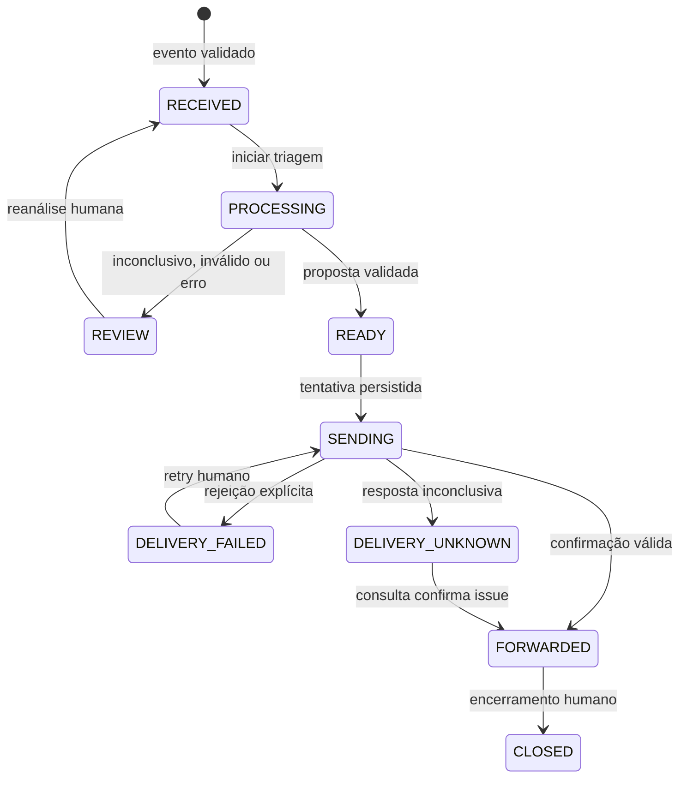

# Decisões de implementação · 06/11/2026

Escolhas feitas para materializar o pedido de implementação, distinguindo-as das decisões anteriores da spec:

| Ponto aberto na spec | Implementação |
| --- | --- |
| Stack | Java 21, Spring Boot 3.5.7, Maven Wrapper, JDBC, Flyway; frontend HTML/CSS/JS servido pela aplicação. |
| Acionamento | Recebe primeiro; operador inicia uma etapa síncrona separada. Sem worker, broker ou scheduler de retries. |
| ID | UUID interno; `(source,eventId)` único e `(source,ticketId)` único; mesmo cliente pode ter chamados diferentes. |
| Igualdade | JSON canônico dos campos tipados + SHA-256. Sem normalização silenciosa de texto. |
| Conflitos | Uma linha por origem/evento/hash divergente. Operador master decide; justificativa obrigatória. Liberação exige novos IDs e mantém vínculo. |
| Catálogo | Uma regra por categoria, edição com versão otimista, remoção lógica e snapshot por análise. |
| IA | Ciclo de ferramenta no Java, seis respostas por padrão, até três chamadas de ferramenta por resposta. Integração HTTP compatível com tool calling; simulador explícito. |
| Encaminhamento | Porta IssueGateway, implementações Demo e GitHub. Equipe e prioridade no título/corpo; sem dependência de labels. |
| Incerteza | SENDING antes do HTTP. Timeout/5xx/resposta inválida → DELIVERY_UNKNOWN. Consulta por marcador; ausência não permite retry. |
| Painel | Quatro colunas: Novos; Revisão e pendências; Encaminhados; Concluídos. Estado detalhado permanece visível. |
| Acesso | Apenas loopback, sem contas; acesso remoto por túnel privado. Proteção de origem, JSON em mutações e Bearer opcional no webhook. |
| Recuperação | PROCESSING com mais de 15 min pode voltar à revisão por decisão humana, com nota auditável. Nunca transforma envio pendente em falha. |

## Estados

Reconciliação não cria issues. `CLOSED` não é consequência automática do envio. Financeiro e técnico não possuem contas separadas.

## Limites intencionais

O backend valida estrutura, invariantes, versão consultada, presença de evidência literal e coerência de prioridade/disponibilidade. A interpretação semântica da mensagem depende do modelo; a existência de uma citação não é uma prova matemática da classificação. Não se promete eliminar toda prompt injection. Ferramentas não permitem ações administrativas, independentemente do texto gerado.

O rastro de ferramentas preserva argumentos aceitos e políticas devolvidas, não credenciais, prompts internos do provedor ou corpos brutos de erro. Tentativas inválidas terminam com razão sanitizada. Não há edição da mensagem original para completar atendimento pelo painel; dados adicionais exigem novo evento/atendimento ou evolução futura do contrato.

O monólito permite trocar integração por interface, mas os serviços conhecem Spring/Store JDBC. Não são exigidos microsserviços nem uma implementação estrita de Clean Architecture. A aula de origem permanece pendente de confirmação por João.

Fontes técnicas consultadas: [requisitos Spring Boot 3.5](https://docs.spring.io/spring-boot/3.5/system-requirements.html), [tool calling OpenAI](https://developers.openai.com/api/docs/guides/function-calling), [criação de issues GitHub](https://docs.github.com/en/rest/issues/issues#create-an-issue). A API HTTP do Hermes foi conferida no código local `gateway/platforms/api_server_openai_routes.py`; seu ciclo não repassa tools externos ao cliente Java.
